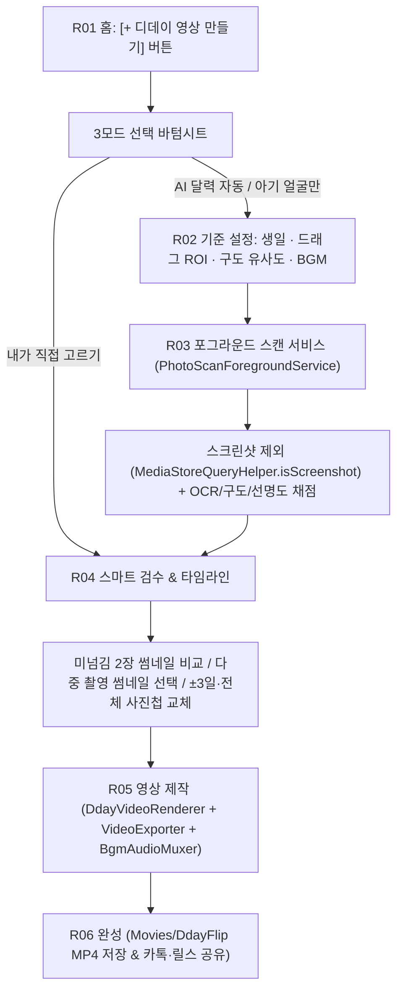

# 처리 흐름과 날짜·선별·영상 합성 파이프라인 (v3.1.1)

## 1. 날짜 세 종류의 정의와 규칙

| 이름 | 출처 | 의미 | 주의 및 보정 규칙 |
|---|---|---|---|
| **찍은 날 (`effectiveDate`)** | 사진 파일의 촬영 정보 (`MediaStore.DATE_TAKEN` / `EXIF`) | 카메라가 기록한 실제 촬영 날짜 | • `DdayCalculator.calculate()`에 넘길 때 `atStartOfDay()`(00:00시)를 쓰면 새벽 4시 이전 보정(`hour < 4`)에 걸려 하루 전날로 밀리므로, 날짜만 있을 때는 반드시 **`atTime(12, 0)`(정오 기준)**을 전달한다. • 출산 전날 기대하며 찍은 사진(`D+0`)도 놓치지 않도록 스캔 시작일은 **`birthday.minusDays(1)`**부터 조회한다. |
| **달력 숫자 (`ocrDday`)** | ML Kit 한국어 OCR + `DdayTextParser` | 사진 속 D-day 달력에 적힌 일수 | • `D+50`, `50일`, `+50` 등 명시적 표기(`isExplicit == true`)는 최우선 신뢰한다. • 단독 숫자(`isExplicit == false`)는 옷·장난감·배경 숫자와 헷갈릴 수 있으므로 **`rawDday == expectedDday`(촬영일 계산 일수와 정확히 일치)**할 때만 인정한다. |
| **생일 기준 일수 (`exifDday`)** | `찍은 날 − 생일` (`ONE_BASED`: 생일 당일 D+1 / `ZERO_BASED`: D+0) | 달력 숫자를 못 읽거나 아기 얼굴 전용 모드일 때의 기준 일수 | • 달력 숫자와 촬영일 계산 일수가 어긋나거나, 이틀 연속 같은 달력 숫자가 찍히면 **스마트 검수(`ReviewScreen`)의 달력 미넘김 의심 카드**로 안내한다. |

---

## 2. 3가지 사진 수집 트랙 (R01 바텀시트 선택)

1. **`✨ AI 달력 사진 자동 찾기 (ScanAccuracyMode.STRICT / RELAXED / HIGH_PRECISION)`**
   - 기준 사진에서 손가락 드래그(`detectDragGestures`)로 지정한 **달력 영역(ROI)**을 우선 크롭하여 ML Kit OCR을 수행한다 (`HIGH_PRECISION` 시 전체 영역 2차 폴백).
   - **`📐 침대/배경 구도 유사도 매칭 (`SceneSimilarityEvaluator`)** 활성화 시 기준 사진과의 4×4 RGB/Luma 그리드 코사인 유사도 점수를 선별 가중치에 반영한다.
2. **`👶 아기 얼굴 사진만 골라 찾기 (ScanAccuracyMode.BABY_FACE_ONLY)`**
   - 달력이 없는 날에도 중앙 영역 아기 피부톤 비율(`computeBabySkinRatio`), 구도 유사도(`computeSimilarity`), 라플라시안 선명도(`ImageSharpnessEvaluator`)를 결합해 날짜별 가장 예쁜 아기 사진을 자동 선별한다.
3. **`🖼️ 앨범에서 내가 직접 고르기 (Direct Photo Picker)`**
   - Android 시스템 포토피커(`ActivityResultContracts.PickMultipleVisualMedia()`)로 원하는 사진만 직접 체크하여 스캔 대기 없이 즉시 스마트 검수 화면(`R04`)으로 진입한다.

---

## 3. 단계별 처리 파이프라인

### 단계별 핵심 로직
1. **노이즈 원천 배제 (`MediaStoreQueryHelper.isScreenshot`)**:
   - `Screenshots` / `스크린샷` 폴더 및 파일명을 기본 제외하되, 가족에게 받은 `KakaoTalk`, `Download`, `Camera` 폴더의 아기 사진은 모두 보존한다.
2. **1일 1장 대표 선별 및 후보 보존 (`CalendarSequenceValidator`)**:
   - 같은 날짜에 여러 장을 찍은 경우 최고 점수 1장을 대표 타임라인에 배치하고, 나머지 사진들도 버리지 않고 당일 후보 목록(`sameDayAlternativeMap`)으로 보존해 검수 화면에서 썸네일을 보고 직접 고를 수 있게 한다.
3. **스마트 검수 & ±3일 사진 교체 (`ReviewScreen`, `PhotoSwapBottomSheet`)**:
   - 특정 날짜 슬롯을 탭하면 당일뿐만 아니라 **앞뒤 ±3일(`minusDays(3)` ~ `plusDays(3)`)** 사진을 당일 우선 순위로 즉시 그리드에 표시하며, 없을 경우 **`[📂 전체 사진첩에서 직접 찾기]`**로 전체 갤러리에서 가져올 수 있다.
4. **비디오/오디오 온디바이스 인코딩 (`DdayVideoRenderer`, `VideoExporter`, `BgmAudioMuxer`)**:
   - 비디오 트랙: 1080×1920 세로 릴스 캔버스 렌더링(D+ 배지, 날짜, 스티커/자막 오버레이) + NV12 버퍼 재사용(`reusableArgbBuffer`)을 통한 GC Zero-Allocation 하드웨어 H.264 인코딩.
   - 오디오 트랙:
     - `BgmMode.DEFAULT_MUSIC_BOX`: 순수 코틀린 신디사이저(`generateMusicBoxPcm`)가 오르골 자장가 벨 엔벨로프 화음을 생성하여 44.1kHz AAC 트랙으로 실시간 인코딩.
     - `BgmMode.CUSTOM_FILE`: 사용자가 선택한 MP3/M4A 오디오 트랙을 `MediaExtractor`로 추출·클리핑(호환되지 않을 경우 내장 오르골로 자동 폴백).
     - `BgmMode.MUTE`: 오디오 트랙 없이 비디오 트랙만 단일 먹싱.
