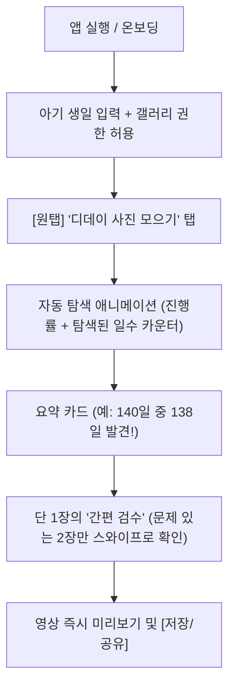
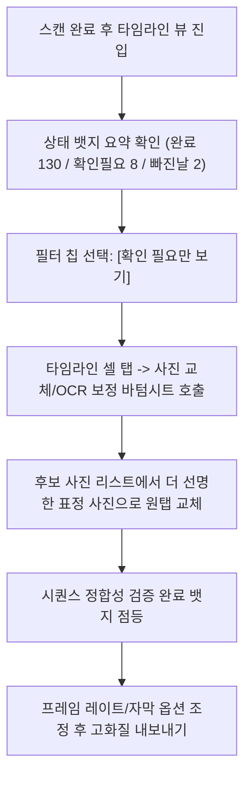
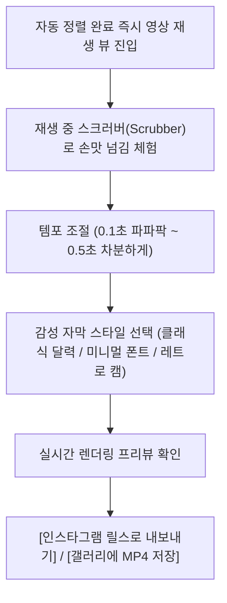

# 디데이 넘김(dday_flip) 안드로이드(갤럭시) 앱 UI/UX 콘셉트 설계서

> **버전**: v1.0 (2026-10-25)  
> **기준 타깃 디바이스**: 삼성 갤럭시 S24 / S24 Ultra (기준 뷰포트: `360 x 800 dp` / `412 x 915 dp`, Density: xxhdpi/xxxhdpi)  
> **핵심 가치**: "앱을 늦게 깔아도 갤러리 속 수천 장에서 D-day 달력 사진을 찾아내 착착 넘겨주는 감동"  
> **디자인 철학**: 프라이버시 우선(로컬 온디바이스), 불필요한 AI 클리셰(보라색 그라디언트, 과도한 박스 중첩) 배제, 높은 정보 밀도와 따뜻한 감성 미니멀리즘.

---

## 0. 공통 디자인 시스템 토큰 (Foundations)

피그마(Figma) 스타일 라이브러리 및 Jetpack Compose 디자인 토큰에 1:1 매핑되는 공통 파운데이션.

### 0.1 컬러 시스템 (Color System)
육아의 피로감을 덜어주는 차분한 내추럴 웜톤(Natural Warmth) 기반. 고대비 원색 및 인위적인 네온/보라색을 배제하고 종이 달력의 질감과 부드러운 스킨톤을 연상시키는 배색.

| 토큰 이름 | Hex Code | 용도 및 가이드 |
|---|---|---|
| `bg-canvas` | `#FBF9F6` | 메인 백그라운드 (미색 웜 화이트, 눈의 피로 최소화) |
| `surface-paper` | `#FFFFFF` | 카드/시트/모달 백그라운드 (순백색, 은은한 종이 질감 연출) |
| `surface-subtle` | `#F4F0EB` | 보조 컨테이너, 칩(Chip), 비활성 인풋 필드 배경 |
| `primary-warm` | `#E06D53` | 테라코타 코랄 (주목성 높은 메인 CTA, 주요 D-day 강조) |
| `primary-soft` | `#F7EBE8` | 코랄 틴트 (선택된 날짜 칩 배경, 강조 뱃지) |
| `secondary-sage`| `#5A7364` | 세이지 그린 (완료 상태, 검수 통과, 안정감 부여) |
| `warning-amber` | `#D97706` | 앰버 오렌지 (확인 필요 건, 달력 미넘김/숫자 불일치 플래그) |
| `text-primary`  | `#1F1E1D` | 본문/타이틀 (완전한 블랙이 아닌 딥 차콜 브라운) |
| `text-secondary`| `#6B6661` | 부연 설명, 타임스탬프, 메타데이터 |
| `text-tertiary` | `#9E9890` | 플레이스홀더, 비활성 텍스트 |
| `line-divider`  | `#EAE5DE` | 구분선, 아웃라인 (과도한 그림자 대신 1px 얇은 선 사용) |

### 0.2 타이포그래피 (Typography)
- **기본 폰트**: 삼성 One UI 최적화 서체 `Pretendard GOV` / `Roboto Flex` / `Noto Sans KR`
- **D-day 숫자 특화**: 단단하고 가독성 높은 고정폭 모노스페이스 또는 클래식 세리프 믹스 (`DM Serif Display` or `Outfit`)

| 텍스트 스타일 | Size / Line-height | Weight | 용도 |
|---|---|---|---|
| `Display.Large` | 32sp / 40sp | Bold (700) | 완성 화면 D-day 카운트, 헤드라인 |
| `Title.Medium` | 20sp / 28sp | SemiBold (600) | 각 화면 메인 타이틀, 모달 제목 |
| `Title.Small` | 16sp / 24sp | Medium (500) | 섹션 헤더, 리스트 타이틀 |
| `Body.Large` | 15sp / 22sp | Regular (400) | 주요 안내 문구, 설정 항목 |
| `Body.Medium` | 13sp / 18sp | Regular (400) | 사진 메타정보 (촬영일시, EXIF 비교) |
| `Number.Counter`| 24sp / 28sp | SemiBold (600) | D+100 등 달력 숫자 강조 |
| `Caption` | 11sp / 14sp | Medium (500) | 상태 뱃지, 도움말 텍스트 |

### 0.3 레이아웃 & 섀도우 규격
- **그리드**: 4dp 배수 베이스라인 그리드 (4, 8, 12, 16, 24, 32dp).
- **스크린 좌우 마진**: `20dp` (갤럭시 한 손 조작 여백 확보).
- **코너 라운딩**:
  - Small: `8dp` (뱃지, 썸네일 내부)
  - Medium: `16dp` (사진 카드, 검수 다이얼로그)
  - Large: `24dp` (바텀 시트 상단, 액션 버튼)
- **엘리베이션(Shadow)**:
  - 무거운 드롭 섀도우 금지. 단일 레벨: `0px 4px 16px rgba(0, 0, 0, 0.04)`, `border: 1px solid #EAE5DE` 병행.

---

## 1. 콘셉트 1: 원탭 메모리북 (One-Tap Memory Book)

### 1.1 디자인 의도 & 타깃 유저 (Why)
- **타깃 유저**: 육아와 일에 지쳐 복잡한 툴이나 편집 앱을 배울 여유가 없는 부모. "알아서 좋은 사진 골라 10초 만에 영상 뽑아줘"를 원하는 사용자.
- **디자인 의도**: 한 손 조작 가능한 단순함. 기술적 용어(OCR, EXIF)를 모두 감추고, 아기 생일과 사진 폴더만 고르면 마법처럼 한 권의 성장 책이 완성되는 따뜻한 UX.

### 1.2 무드 & 키워드
- **키워드**: `정온함(Calm)`, `단순함(Effortless)`, `소중함(Cherished)`, `종이책 감성(Paper Touch)`
- **시각적 특징**: 불필요한 설정 창을 과감히 제거. 큰 폰트, 넓은 터치 영역, 책장을 넘기는 듯한 부드러운 햅틱 반응.

### 1.3 사용자 여정 (User Flow)


### 1.4 주요 화면 와이어프레임 & 피그마 프레임 명세

#### Frame 101: 홈 메인 (Home - Standby)
```
+------------------------------------------+
| 10:00                          [설정] ⚙️ |
|                                          |
|  아가의 매일 달력을                      |
|  한 편의 넘김 책으로 만들어요            |
|                                          |
|  +------------------------------------+  |
|  |  아기 생일: 2026.05.15 [변경]      |  |
|  |  대상: 최근 갤러리 사진 (전체)     |  |
|  +------------------------------------+  |
|                                          |
|                                          |
|             [ 일러스트/아이콘 ]          |
|              달력과 아기 발도장          |
|                                          |
|                                          |
|  +------------------------------------+  |
|  |                                    |  |
|  |    [   ✨ 매일 사진 모으기   ]     |  |
|  |                                    |  |
|  +------------------------------------+  |
|  기기 안에서만 안전하게 분석해요 (안심)  |
+------------------------------------------+
```
- **주요 컴포넌트**:
  - `HeroText`: 24sp Bold. 부모를 맞이하는 감성 카피.
  - `BabyProfileCard`: 생일과 검색 범위를 단일 라인으로 표시 (`surface-paper`, `radius: 16dp`).
  - `PrimaryLargeButton`: 높이 56dp, `primary-warm` 배경, 햅틱 피드백 적용.

#### Frame 102: 실시간 분석 중 (Analyzing - Ambient Progress)
```
+------------------------------------------+
|                                          |
|                                          |
|               [ 74% ]                    |
|          1,420장 중 1,050장 분석 중...   |
|                                          |
|     +------------------------------+     |
|     |  [== 썸네일 실시간 롤링 ==]  |     |
|     +------------------------------+     |
|                                          |
|          "D+42 달력을 찾았어요!"        |
|                                          |
|          [ 현재까지 모은 날: 82일 ]      |
|                                          |
|  [ 취소 ]                                |
+------------------------------------------+
```
- **주요 인터랙션**: 중앙에 발견된 달력 사진들이 부드러운 페이드인으로 전환되며 부모에게 "잘 찾아지고 있구나"라는 시각적 신뢰 제공.

#### Frame 103: 원터치 검수 및 완성 (Review & Export)
```
+------------------------------------------+
| <- 뒤로                     내보내기 [v] |
|                                          |
|  총 140일 중 138일을 찾았어요!           |
|  확인이 필요한 날이 2장 있어요           |
|                                          |
|  +------------------------------------+  |
|  | [경고] D+45 달력 숫자가 안 보여요  |  |
|  | +--------------------------------+ |  |
|  | |                                | |  |
|  | |          [사진 썸네일]         | |  |
|  | |                                | |  |
|  | +--------------------------------+ |  |
|  | 찍은 날짜로 맞출까요? (2026.06.29) |  |
|  | [이 사진 제외]     [이 사진으로 사용]|  |
|  +------------------------------------+  |
|                                          |
|  [ 1 / 2 건 확인 중 ]                    |
|                                          |
|  +------------------------------------+  |
|  |      [  🎬 완성 영상 만들기  ]      |  |
|  +------------------------------------+  |
+------------------------------------------+
```
- **디자인 포인트**: 140장을 전부 나열하지 않고, 확인이 필요한 2건만 카드 스와이프로 3초 안에 끝내도록 유도.

### 1.5 장단점 및 추천 상황
- **장점**: 인지 부하 제로. 설치 후 1분 안에 첫 결과물을 볼 수 있어 리텐션과 첫인상 만족도 극대화.
- **단점**: 특정 날짜의 사진을 다른 구도의 사진으로 바꾸고 싶어 하는 디테일한 유저에겐 제어권 부족.
- **추천**: 일반 육아 부모 대상 기본 출시 모드로 가장 추천.

---

## 2. 콘셉트 2: 인텔리전트 타임라인 (Intelligent Timeline Studio)

### 2.1 디자인 의도 & 타깃 유저 (Why)
- **타깃 유저**: "D+10부터 D+150까지 하루도 빠짐없이 완벽하게 기록하고 싶다"는 꼼꼼한 부모, 사진이 여러 장일 때 가장 예쁜 표정의 사진을 직접 고르고 싶은 유저.
- **디자인 의도**: 달력 그리드(Calendar Sheet)와 시퀀스 바를 통해 결측일, 중복일, 판독 모호 건을 투명하게 시각화하고 직관적으로 탭하여 교체하는 스튜디오형 UX.

### 2.2 무드 & 키워드
- **키워드**: `정밀함(Precision)`, `신뢰(Reliability)`, `체계적(Structured)`, `아카이빙(Archiving)`
- **시각적 특징**: 정보 밀도가 높지만 정돈된 그리드. 갤럭시의 대화면을 활용하여 한눈에 100일간의 여정을 파악할 수 있는 스크롤 타임라인.

### 2.3 사용자 여정 (User Flow)


### 2.4 주요 화면 와이어프레임 & 피그마 프레임 명세

#### Frame 201: 타임라인 메인 대시보드 (Studio Timeline)
```
+------------------------------------------+
| 10:00                     [미리보기] [저장]|
|                                          |
| 140일 여정 타임라인           (D+10~D+150) |
| [전체 140] [확인필요 8] [결측 2] [완료 130]|
|------------------------------------------|
| [ 그리드 뷰 (3열) ]                      |
|                                          |
| +----------+ +----------+ +----------+   |
| | D+10  v  | | D+11  v  | | D+12  !  |   |
| | [사진]   | | [사진]   | | [불일치] |   |
| | 05.25    | | 05.26    | | 05.27    |   |
| +----------+ +----------+ +----------+   |
|                                          |
| +----------+ +----------+ +----------+   |
| | D+13  v  | | D+14  X  | | D+15  v  |   |
| | [사진]   | | [빠진날] | | [사진]   |   |
| | 05.28    | | 사진추가 | | 05.30    |   |
| +----------+ +----------+ +----------+   |
|                                          |
|  ... (부드러운 버티컬 스크롤)            |
|                                          |
| +--------------------------------------+ |
| | 하단 플로팅 바:                       | |
| | [ 8개 이슈 남음 ]   [자동 보정하기 >] | |
| +--------------------------------------+ |
+------------------------------------------+
```
- **주요 컴포넌트**:
  - `FilterChipGroup`: 전체, 확인필요(`warning-amber`), 결측, 완료(`secondary-sage`).
  - `TimelineGridCell`: 정방형(1:1) 사진 썸네일 + 좌상단 D-day 오버레이 + 우상단 상태 아이콘(체크, 느낌표, 플러스).
  - `BottomIssueDock`: 해결해야 할 이슈를 요약하고 일괄 해결 추천 제공.

#### Frame 202: 셀 상세 검수 바텀시트 (Inspection Bottom Sheet)
```
+------------------------------------------+
| [====== 드래그 핸들 ======]              |
|                                          |
| D+12 상세 검수                  [닫기 X] |
|                                          |
|  +-------------------+  인식 정보:       |
|  |                   |  - 달력 OCR: D+11 |
|  |     현재 선택     |  - 촬영일: 05.27  |
|  |      사진 원본    |  - 추정일: D+12   |
|  |                   |  * 달력 미넘김 의심|
|  +-------------------+                   |
|                                          |
|  [당일 다른 후보 사진 3장]               |
|  +------+ +------+ +------+              |
|  |사진 1| |사진 2| |사진 3|              |
|  +------+ +------+ +------+              |
|                                          |
|  선택 액션:                              |
|  (•) D+12로 숫자 보정하여 사용           |
|  ( ) 달력 그대로 D+11로 유지             |
|  ( ) 이 날짜는 건너뛰기                  |
|                                          |
|  +------------------------------------+  |
|  |           [ 변경사항 적용 ]         |  |
|  +------------------------------------+  |
+------------------------------------------+
```
- **디자인 포인트**: 사용자가 왜 이 사진이 걸렸는지(달력 미넘김인지, 흔들림인지) 명확한 근거 데이터를 제공하여 불필요한 의구심 해소.

### 2.5 장단점 및 추천 상황
- **장점**: 높은 신뢰성과 완전한 통제권. 결과물에 결측이나 오차가 발생하지 않도록 완벽히 보정 가능.
- **단점**: 초보 부모에게는 다소 정보량이 많고 작업이 복잡해 보일 수 있음.
- **추천**: 사진 촬영 습관이 불규칙하거나 수동 정리를 즐기는 파워 유저를 위한 고급 모드로 적합.

---

## 3. 콘셉트 3: 릴스/쇼츠 퀵스냅 (Reel & Flip Snap)

### 3.1 디자인 의도 & 타깃 유저 (Why)
- **타깃 유저**: 인스타그램 릴스, 유튜브 쇼츠, 카카오톡 프로필에 아이의 100일/돌 성장 영상을 세련되게 공유하고 싶은 트렌디한 MZ 부모.
- **디자인 의도**: 생성될 영상의 비주얼 퀄리티와 리듬감에 집중. 실시간 넘김 햅틱 슬라이더, 감성 타이포그래피 오버레이, 9:16 세로 비율 최적화 UI.

### 3.2 무드 & 키워드
- **키워드**: `리듬감(Rhythm)`, `인스타그래머블(Instagrammable)`, `스냅(Snappy)`, `감각적(Sensory)`
- **시각적 특징**: 다크/미드톤 프리뷰 뷰어, 아날로그 플립 시계 모션, 0.1초 단위의 정밀한 템포 컨트롤러, 원탭 SNS 내보내기.

### 3.3 사용자 여정 (User Flow)


### 3.4 주요 화면 와이어프레임 & 피그마 프레임 명세

#### Frame 301: 숏폼 플레이어 & 템포 스튜디오 (Player & Style)
```
+------------------------------------------+
| 10:00                     [음악 추가] 🎵 |
|                                          |
|  +------------------------------------+  |
|  |                                    |  |
|  |                                    |  |
|  |           [ 9:16 영상 영역 ]       |  |
|  |                                    |  |
|  |           아기 사진 + 달력          |  |
|  |                                    |  |
|  |     ┌────────────────────────┐     |  |
|  |     │  D + 1 0 0             │     |  |
|  |     │  2026. 08. 23          │     |  |
|  |     └────────────────────────┘     |  |
|  |       (착! 넘어가는 플립 애니메이션) |  |
|  +------------------------------------+  |
|                                          |
|  |<<   [ ▶ 재생 / ■ 정지 ]   >>|  D+78/140|
|  ================================[●]==== |
|                                          |
|  [넘김 속도]                             |
|  느리게 (0.5s) --- [●] --- 빠르게 (0.1s)  |
|                                          |
|  [자막 디자인]                           |
|  +----------+ +----------+ +----------+  |
|  | [클래식] | | [감성필름]| | [미니멀] |  |
|  +----------+ +----------+ +----------+  |
|                                          |
|  +------------------------------------+  |
|  |    [  🚀 9:16 고화질 릴스 내보내기 ]  |  |
|  +------------------------------------+  |
+------------------------------------------+
```
- **주요 인터랙션**:
  - `FlipScrubber`: 하단 타임라인을 손가락으로 드래그할 때마다 진동 모터(햅틱)가 틱틱 울리며 종이 달력이 한 장씩 넘어가는 촉각 피드백 구현.
  - `SpeedSlider`: 넘김 템포를 바꿀 때 상단 프리뷰에 즉시 반영.

#### Frame 302: 넘김 전환 효과 및 자막 커스텀 시트 (Transition & Overlay)
```
+------------------------------------------+
| [====== 스타일 커스텀 ======]            |
|                                          |
|  넘김 애니메이션:                        |
|  [ (•) 착착 플립 ]  [ ( ) 크로스 페이드 ]|
|  [ ( ) 스와이프  ]  [ ( ) 하드 컷(기본) ]|
|                                          |
|  D-day 자막 위치:                        |
|  [ 좌하단 ]  [ 중앙하단 (기본) ]  [ 숨김 ] |
|                                          |
|  비율 맞춤:                              |
|  (•) 9:16 꽉 찬 화면 (인물 중심 스마트 크롭)|
|  ( ) 원본 비율 유지 (블러 배경 채움)     |
|                                          |
|  +------------------------------------+  |
|  |            [ 스타일 적용 ]          |  |
|  +------------------------------------+  |
+------------------------------------------+
```

### 3.5 장단점 및 추천 상황
- **장점**: 결과물의 바이럴 및 공유 가치가 가장 높음. 넘겨보는 손맛(미세 햅틱)이 주는 쾌감이 뛰어남.
- **단점**: 검수 과정이 생략되거나 축소되어 있어, 사진 순서가 어긋났을 때 수정 동선이 다소 길어질 수 있음.
- **추천**: 소셜 미디어 공유가 목적인 감각적인 부모층 타깃.

---

## 4. 3가지 콘셉트 종합 비교 매트릭스

| 평가 항목 | 콘셉트 1: 원탭 메모리북 | 콘셉트 2: 인텔리전트 타임라인 | 콘셉트 3: 릴스/쇼츠 퀵스냅 |
|---|---|---|---|
| **핵심 페르소나** | 바쁜 워킹맘/워킹대디 | 꼼꼼한 기록가/아카이버 | SNS 공유를 즐기는 MZ 부모 |
| **작업 소요 시간** | **1분 이내 (최소)** | 3~5분 (정밀 검수) | 2분 내외 (스타일 튜닝) |
| **제어 및 편집 자유도**| 낮음 (자동화 중심) | **매우 높음 (셀 단위 제어)** | 중간 (영상 스타일 중심) |
| **UI 복잡도 (인지부하)**| **매우 낮음 (★☆☆☆☆)** | 중간 (★★★☆☆) | 낮음~중간 (★★☆☆☆) |
| **감성 만족도 포인트** | "알아서 다 해줬네" 안도감 | "단 하루도 빠짐없다" 뿌듯함 | "우리 아기 모델 같네" 자랑스러움 |
| **피그마 작업 난이도** | 쉬움 (기본 화면 4장) | 중간 (그리드/상태 컴포넌트) | 중간 (플레이어/컨트롤러 UI) |

---

## 5. 피그마(Figma) 컴포넌트 구조화 가이드 (실무 핸드오프용)

피그마 작업 시 아래 구조로 컴포넌트 세트(Component Set)를 생성하면 개발팀(Jetpack Compose)과 1:1로 정확하게 일치시킬 수 있습니다.

### 5.1 네이밍 규칙 & 프로퍼티 매핑
- `Component / TimelineCard`
  - `State`: `Default` | `Selected` | `Warning` | `Missing`
  - `Resolution`: `High` | `Low`
- `Component / DDayBadge`
  - `Type`: `Contained` | `Outlined` | `Overlay`
  - `Status`: `Normal` | `Alert`
- `Component / BottomDockAction`
  - `Mode`: `SingleButton` | `TwoButton` | `IssueSummary`

### 5.2 추천 권장 프로덕션 전략 (Hybrid Rollout)
피그마 설계 및 실제 안드로이드 2단계 개발 시 **"콘셉트 1(원탭 기본) + 콘셉트 2(상세 보기 탭)"**의 하이브리드 접근을 권장합니다:
1. **첫 진입 및 기본 플로우**: 콘셉트 1(원탭 메모리북)로 빠르게 완성 영상과 감동을 선사.
2. **더 다듬고 싶을 때**: "상세 수정하기"를 누르면 콘셉트 2(인텔리전트 타임라인)의 그리드가 열리며 세부 사진 교체 지원.
3. **내보내기 단계**: 콘셉트 3의 템포 조절 슬라이더와 햅틱 인터랙션을 적용하여 저장.
