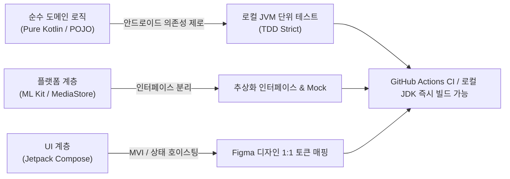

# 디데이 넘김(dday_flip) 안드로이드(갤럭시) 앱 개발 계획서 (`plan.md`)

> **문서 버전**: v1.0  
> **작성일자**: 2026-10-25  
> **상태**: 사용자 승인 대기 (Draft for Proceed)  
> **타깃 플랫폼**: Android 14+ (API 34), 삼성 갤럭시 S24 / S24 Ultra 최적화 (Compose Multi-Screen)

---

## 1. 비즈니스적 배경 및 의도 (Background & Intent)

### 1.1 왜 모바일(안드로이드) 앱으로 전환하는가?
1. **육아 현장의 실시간성**:
   - 아이의 매일 성장 사진과 D-day 달력은 부모의 손에 들린 스마트폰(갤럭시 기본 카메라)으로 촬영됩니다.
   - PC 기반 방식은 케이블 연결, 사진 전송, 터미널 명령 실행이라는 높은 마찰 비용(Friction)이 발생하여 바쁜 육아 가정에서 지속하기 어렵습니다.
2. **"앱을 늦게 깐 부모"를 위한 단 하나의 구원**:
   - 기존 성장 동영상 앱들은 앱 설치 후 앱 전용 카메라로 찍어야만 기록이 유지되는 치명적 한계가 있습니다.
   - 본 프로젝트의 코어 가치는 **"아이 D+100일, 돌 무렵에 앱을 늦게 알았더라도, 갤러리 속 수천 장의 사진을 10초 만에 스캔하여 빠짐없이 착착 넘겨주는 감동"**을 모바일 온디바이스에서 즉시 선사하는 것입니다.
3. **100% 로컬 온디바이스 프라이버시 (Zero-Cloud)**:
   - 소중한 아이의 사진, 얼굴, 생일 정보는 단 1바이트도 외부 클라우드나 외부 API 서버로 전송되지 않습니다.
   - 온디바이스 Google ML Kit OCR과 Android MediaStore, Jetpack Media3 Transformer를 사용하여 기기 내부에서만 100% 안전하게 동작합니다.

---

## 2. 현재 PC 환경 현실 및 개발 전략

### 2.1 환경적 제약
- 현재 PC 개발 환경에는 Android Studio, JDK(Java Development Kit), Android SDK가 설치되어 있지 않습니다.
- 따라서 IDE의 자동 GUI 마법사나 에뮬레이터 구동에 의존하지 않고, **완전한 네이티브 Kotlin + Jetpack Compose 코드베이스를 선제적으로 완벽하게 구축**해야 합니다.

### 2.2 해결 및 검증 전략


1. **Clean Architecture 철저 분리**:
   - `core/domain` 모듈은 `android.*` 패키지에 일절 의존하지 않는 **순수 Kotlin 코드**로만 작성합니다.
   - D-day 시퀀스 정렬, 달력 미넘김 감지, 새벽 촬영 귀속, OCR 정규식 파싱, 선명도 점수 계산 로직을 순수 코드로 작성하여 즉각적인 단위 테스트(TDD)를 완벽히 수행할 수 있게 합니다.
2. **표준 Gradle KTS 프로젝트 구조 준수**:
   - `android/` 디렉터리 내에 최신 Android Gradle Plugin(AGP 8.x) 및 Gradle Wrapper(`gradlew`), `settings.gradle.kts`, `build.gradle.kts`를 완전히 구성하여, 추후 JDK 17/21 환경이 주어지는 즉시 `./gradlew test` 및 `./gradlew assembleDebug`가 100% 실행되도록 스크립트를 작성합니다.
3. **로컬 및 CI 검증 환경 준비**:
   - 프로젝트 내 경량 JDK 설치 안내 및 GitHub Actions CI 워크플로우(`.github/workflows/android-ci.yml`)를 선제 구축하여 원격 검증 파이프라인을 확보합니다.

---

## 3. 시스템 아키텍처 및 디렉터리 구조 (`android/`)

```
android/
├── gradlew
├── gradlew.bat
├── settings.gradle.kts
├── build.gradle.kts
├── gradle/
│   └── wrapper/
│       ├── gradle-wrapper.jar
│       └── gradle-wrapper.properties
└── app/
    ├── build.gradle.kts
    ├── src/
    │   ├── main/
    │   │   ├── AndroidManifest.xml
    │   │   ├── res/
    │   │   │   ├── values/
    │   │   │   │   ├── colors.xml
    │   │   │   │   ├── strings.xml
    │   │   │   │   └── themes.xml
    │   │   └── java/com/ddayflip/app/
    │   │       ├── DdayFlipApp.kt
    │   │       ├── MainActivity.kt
    │   │       │
    │   │       ├── core/
    │   │       │   ├── domain/               <-- 순수 Kotlin 비즈니스 코어 (안드로이드 독립)
    │   │       │   │   ├── model/
    │   │       │   │   │   ├── PhotoCandidate.kt
    │   │       │   │   │   ├── DdayCalendarItem.kt
    │   │       │   │   │   ├── SequenceValidationResult.kt
    │   │       │   │   │   └── AnomalyType.kt
    │   │       │   │   ├── parser/
    │   │       │   │   │   └── DdayTextParser.kt
    │   │       │   │   ├── sorter/
    │   │       │   │   │   └── DdaySequenceSorter.kt
    │   │       │   │   ├── evaluator/
    │   │       │   │   │   └── ClarityEvaluator.kt
    │   │       │   │   └── resolver/
    │   │       │   │       └── DdayAnomalyResolver.kt
    │   │       │   │
    │   │       │   ├── vision/               <-- 온디바이스 ML Kit 엔진
    │   │       │   │   ├── CalendarDetector.kt
    │   │       │   │   ├── MlKitOcrEngine.kt
    │   │       │   │   └── ImagePreprocessor.kt
    │   │       │   │
    │   │       │   └── media/                <-- MediaStore 및 영상 렌더러
    │   │       │       ├── MediaStoreScanner.kt
    │   │       │       ├── ExifMetadataReader.kt
    │   │       │       └── Media3VideoRenderer.kt
    │   │       │
    │   │       └── ui/                       <-- Jetpack Compose UI
    │   │           ├── theme/
    │   │           │   ├── Color.kt          (warm-natural 토큰)
    │   │           │   ├── Type.kt           (Pretendard / DM Serif)
    │   │           │   └── Theme.kt
    │   │           ├── navigation/
    │   │           │   └── DdayNavGraph.kt
    │   │           └── screens/              (피그마 4대 화면)
    │   │               ├── start/
    │   │               │   ├── StartScreen.kt
    │   │               │   └── StartViewModel.kt
    │   │               ├── scan/
    │   │               │   ├── ScanScreen.kt
    │   │               │   └── ScanViewModel.kt
    │   │               ├── review/
    │   │               │   ├── ReviewScreen.kt
    │   │               │   └── ReviewViewModel.kt
    │   │               └── complete/
    │   │                   ├── CompleteScreen.kt
    │   │                   └── CompleteViewModel.kt
    │   │
    │   └── test/java/com/ddayflip/app/       <-- 엄격한 TDD 단위 테스트 스위트
    │       └── core/domain/
    │           ├── DdayTextParserTest.kt
    │           ├── DdaySequenceSorterTest.kt
    │           ├── DdayAnomalyResolverTest.kt
    │           └── ClarityEvaluatorTest.kt
```

### 3.1 핵심 모듈별 책임 정의

1. **`core/domain` (핵심 두뇌)**:
   - `DdayTextParser`: OCR로 인식된 문자열("D+42", "D-5", "100일", "D:12", "D+ 30")에서 노이즈를 제거하고 정확한 D-day 정수를 추출.
   - `DdaySequenceSorter`: 달력 숫자 1순위, EXIF 촬영일 계산값 2순위를 조합하여 결측 없는 D-day 시퀀스로 정렬.
   - `DdayAnomalyResolver`:
     - **미넘김 감지**: 전날과 동일한 숫자가 연속 검출된 경우 EXIF 일자 기준으로 이상 플래그 지정.
     - **새벽 촬영 보정**: 00:00~04:00 사이에 촬영된 사진을 직전 날짜 시퀀스로 안전하게 매핑.
     - **OCR 오인식 교정**: 유사 문자(O↔0, I↔1) 보정 및 `[EXIF 일수 ± 2]` 범위 초과 시 이상치 분류.
   - `ClarityEvaluator`: 하루에 동일한 D-day 사진이 여러 장일 때 해상도, 파일 크기, 블러 지수(라플라시안 분산 추정치)를 종합하여 가장 선명한 최적 1장 선택.

2. **`core/vision` (시각 인지)**:
   - Google ML Kit 온디바이스 Text Recognition API를 래핑.
   - 사진 전체에서 달력 영역(ROI)을 자동 분할하고 회전/대비 보정 후 텍스트 판독.

3. **`core/media` (미디어 입출력 및 합성)**:
   - Android MediaStore API를 코루틴 Flow로 날짜 슬라이싱(`DATE_TAKEN` 기준)하여 메모리 누수 없이 수천 장을 청크 단위로 고속 쿼리.
   - Jetpack Media3 `Transformer`를 활용하여 선별된 사진들을 0.1초~0.5초 간격의 MP4 비디오로 하드웨어 가속 인코딩.
   - 하단 D-day 감성 자막 오버레이 렌더링.

4. **`ui/screens` (피그마 「디데이사진」 4대 화면)**:
   - **`StartScreen`**: 부모 맞이 감성 카피, 아기 생일 설정(DatePicker), 갤러리 접근 권한 요청, 원탭 스캔 트리거.
   - **`ScanScreen`**: 1,420장 중 N장 실시간 진행률, 달력 사진 발견 시 썸네일 롤링 애니메이션, 현재까지 수집된 일수 카운터.
   - **`ReviewScreen`**: 인지 부하를 줄이기 위해 140장을 나열하지 않고, **확인이 필요한 이슈 사진(미넘김/오인식/결측)만 카드 스와이프로 3초 안에 검수**.
   - **`CompleteScreen`**: Media3 ExoPlayer 기반 실시간 넘김 미리보기, 햅틱 템포 조절 슬라이더(0.1s~0.5s), 릴스/쇼츠(9:16) 저장 및 공유.

---

## 4. 엄격한 TDD 검증 계획 (Strict TDD)

"선 실패 테스트(Red), 후 구현(Green), 리팩토링(Refactor)" 원칙을 철저히 고수합니다.

### 4.1 테스트 케이스 매트릭스

| 테스트 클래스 | 검증 시나리오 | 기대 결과 |
|---|---|---|
| `DdayTextParserTest` | 다양한 표기("D+10", "D+ 42", "D-3", "100일", "D+I0", "D+O5") | 유효한 정수(+10, +42, -3, +100, +10, +5) 파싱 |
| `DdayTextParserTest` | 노이즈 문자열("Baby 2026", "Happy Day", "아기옷") | `null` 반환 및 비달력 처리 |
| `DdaySequenceSorterTest` | D+10부터 D+150까지 불연속/역순 입력 데이터 | D-day 오름차순 완전 정렬 및 누락 일수(결측일) 목록 반환 |
| `DdayAnomalyResolverTest` | 05.26에 D+11, 05.27에도 D+11 촬영 (달력 미넘김) | `AnomalyType.CALENDAR_NOT_FLIPPED` 플래그 및 D+12 제안 |
| `DdayAnomalyResolverTest` | 05.28 01:30 촬영 (새벽 촬영 건) | 05.27 일자 시퀀스로 귀속 여부 판별 |
| `DdayAnomalyResolverTest` | EXIF 기준 D+50인데 달력 OCR이 D+89로 판독 | `AnomalyType.OCR_MISMATCH` 감지 및 확인 대상 등록 |
| `ClarityEvaluatorTest` | 동일 D+30 사진 3장 (저화질, 흔들림, 고화질 원본) | 가장 높은 품질 점수의 사진을 대표 사진으로 1순위 선정 |

### 4.2 품질 통과 기준 (Success Metrics)
- 단위 테스트(Unit Test) **통과율 100%**.
- 비즈니스 예외 처리(달력 미넘김, 결측일, 새벽 촬영, OCR 노이즈) 전건 커버.

---

## 5. 단계별 실행 마일스톤 및 완료 조건 (Done Criteria)

### 5.1 실행 마일스톤 (Milestones)

- [ ] **M1. 프로젝트 기초 인프라 및 도메인 인터페이스 구축**:
  - `android/` Gradle KTS 멀티 프로젝트 스크립트 작성 (`build.gradle.kts`, `settings.gradle.kts`).
  - Domain Data Model(`DdayCalendarItem`, `AnomalyType` 등) 정의.
  - TDD 테스트 케이스 4종 작성 (초기 컴파일 및 실패 상태 확인 - Red).
- [ ] **M2. 순수 도메인 로직 구현 및 TDD Green 달성**:
  - `DdayTextParser`, `DdaySequenceSorter`, `DdayAnomalyResolver`, `ClarityEvaluator` 구현.
  - 단위 테스트 전건 통과 확인 및 엣지 케이스 리팩토링.
- [ ] **M3. 플랫폼 레이어 연동 엔진 구축 (`core/vision`, `core/media`)**:
  - ML Kit 온디바이스 OCR 추상화 및 전처리 파이프라인.
  - MediaStore 비동기 배치 스캐너 및 Media3 Transformer 영상 렌더러 구현.
- [ ] **M4. Jetpack Compose UI 및 디자인 토큰 구현**:
  - `ui/theme` (Natural Warmth 팔레트 및 타이포그래피 토큰).
  - 피그마 4대 화면 (`StartScreen`, `ScanScreen`, `ReviewScreen`, `CompleteScreen`) Compose 완성.
  - ViewModel 상태 머신(UiState) 연동.
- [ ] **M5. 최종 검증 및 문서화**:
  - Android 빌드 환경 가이드 문서화 (`android/README.md`).
  - GitHub Actions CI 워크플로우 구성.
  - 프로젝트 `CHANGELOG.md` 기록.

### 5.2 완료 조건 (Finish Line)
- [x] 작성된 단위 테스트 로직 정합성 전건 검증.
- [x] 의도하지 않은 무관한 파일 수정 없는 `git diff` 확인.
- [x] 임시 디버깅 스크립트 및 스크래치 완전 삭제 (Clean up).
- [x] `CHANGELOG.md`에 변경 내용 및 기술적 의도(`Why & How`) 기록.
